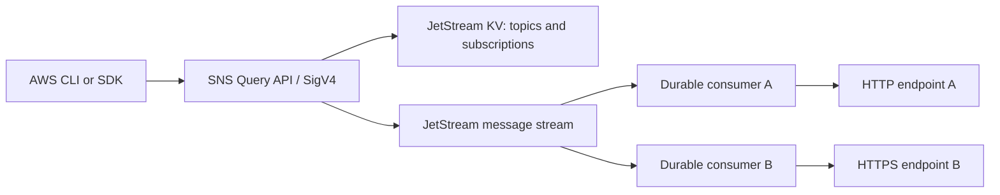

# SNS gateway

A Go implementation of the AWS SNS Query API with interchangeable NATS JetStream and in-memory backends. The default backend is NATS. The module and directory layout follow the neighboring `s3-gateway`: protocol handling lives in `gateway`, persistence adapters in `backend`, and the executable in `cmd/gateway`.

This is an initial **standard-topic, HTTP/HTTPS** implementation. It is not full SNS conformance. See [COMPATIBILITY.md](COMPATIBILITY.md) for supported operations, verification status, and limits.

## Why NATS

JetStream provides persistent messages, independent durable consumers, acknowledgements, and redelivery. These map directly to topic fan-out and per-subscription webhook delivery. Core NATS alone does not provide the required persistence. See the [JetStream documentation](https://docs.nats.io/learn/jetstream/).

MQTT is useful when device connectivity drives the design. Temporal is useful when notifications become multi-step workflows. For the initial publish/fan-out service, JetStream is the selected backend; the interface keeps future alternatives possible.



## Run

Requires Go 1.27.1 or newer. Resolve dependencies first:

```sh
go mod tidy
cp .env.example .env
# Replace SNS_SECRET_KEY in .env before running.
```

With Docker Compose, `.env` supplies the credentials:

```sh
docker compose up --build
```

This starts a local NATS server with JetStream storage in a named volume and the gateway at `http://127.0.0.1:9001`. NATS is exposed only on the host loopback interface. The Compose broker is a local development fixture without broker authentication.

For a host process, export credentials and use an existing NATS server:

```sh
export SNS_ACCESS_KEY=gateway-local
export SNS_SECRET_KEY='choose-a-long-random-secret'
export NATS_URL=nats://127.0.0.1:4222
go run ./cmd/gateway -backend nats
```

Or run without an external broker for development:

```sh
go run ./cmd/gateway -backend memory
```

The memory backend loses metadata, signing keys, and queued messages when the process stops. NATS retains them. The binary reads environment variables; `task run` additionally loads `.env` when [Task](https://taskfile.dev/) is installed.

## Development server

With Go, Docker Compose, and Task installed:

```sh
task dev
```

This resolves Go dependencies, starts the local NATS container, waits for its health check, and runs the gateway on the host with `--debug`. It loads `.env` and otherwise uses the local development credentials `gateway-local` / `gateway-local-dev-secret`. It connects to the managed broker at `nats://127.0.0.1:4222`. Restart `task dev` after Go code changes; automatic file watching is not included.

```sh
task dev -- --listen 127.0.0.1:9010 --public-url http://127.0.0.1:9010
task dev-stop
```

Ctrl+C stops the gateway; the broker remains running for the next session. `task dev-stop` stops it and preserves its data. Use `task run -- --debug` to run with your configured backend without starting Docker.

## Event logging

Pass `--debug` (or `-debug`) to emit structured debug events to stderr:

```sh
go run ./cmd/gateway --debug
```

Events include `api.operation`, `api.response`, `api.error`, `message.accepted`, `worker.started`, `delivery.attempt`, `delivery.response`, `delivery.retry_scheduled`, `delivery.acknowledged`, `delivery.filtered`, `delivery.discarded`, and NATS connection changes. API events carry request IDs; publish and delivery events carry message IDs; delivery events identify subscriptions. Response events include status and duration. Payloads, message attributes, authorization headers, confirmation tokens, and webhook URLs are excluded from these event fields.

Without `--debug`, startup information, warnings, and errors remain visible. Library users can provide a `slog.Logger` through `gateway.Options.Logger` to choose JSON output or another sink.

## Go client and server examples

Run these in three terminals from the repository root:

```sh
task dev             # Gateway and NATS
task example-server  # Subscribe and receive HTTP notifications
task example-client  # Publish a message with the AWS SNS Go SDK
```

Wait for the example server's `Ready on topic ...` message before publishing. Send a custom message with `task example-client -- --message 'Hello from Go!'`. The server confirms its subscription automatically, verifies incoming signatures, and unsubscribes on Ctrl+C.

See [the Go examples](examples/go/README.md) for source code, configuration, and Docker callback URLs.

To try subscription filtering, run `task example-filtering` with the gateway running. It subscribes its own webhook and publishes three events; only the matching order is delivered. Stop it with Ctrl+C, then run `task example-filtering -- --scope MessageBody` to try nested JSON-body filtering. See [filtering/main.go](examples/go/filtering/main.go) and the [example walkthrough](examples/go/README.md#filtering-example).

## AWS CLI example

```sh
export AWS_ACCESS_KEY_ID="$SNS_ACCESS_KEY"
export AWS_SECRET_ACCESS_KEY="$SNS_SECRET_KEY"
export AWS_DEFAULT_REGION=us-east-1

aws --endpoint-url http://127.0.0.1:9001 sns create-topic --name orders

aws --endpoint-url http://127.0.0.1:9001 sns subscribe \
  --topic-arn arn:aws:sns:us-east-1:000000000000:orders \
  --protocol https \
  --notification-endpoint https://your-webhook.example/sns \
  --return-subscription-arn

# The webhook receives SubscriptionConfirmation and follows its SubscribeURL.
# It can also confirm using the token from that message:
aws --endpoint-url http://127.0.0.1:9001 sns confirm-subscription \
  --topic-arn arn:aws:sns:us-east-1:000000000000:orders \
  --token TOKEN_FROM_CONFIRMATION

aws --endpoint-url http://127.0.0.1:9001 sns publish \
  --topic-arn arn:aws:sns:us-east-1:000000000000:orders \
  --message '{"order_id":"123"}'
```

SDK clients should set their SNS endpoint URL to the gateway, use the configured signing region, and use the same static credentials. No AWS account is contacted.

`SNS_PUBLIC_URL` must be reachable by the webhook: it supplies confirmation, unsubscribe, and signing-certificate URLs. Set it to a hostname accessible from the subscriber when using containers or remote webhooks. The default loopback URL works only for subscribers on the same host. A container can reach a host webhook through `host.docker.internal` on Docker Desktop.

## Delivery behavior

HTTP/HTTPS subscriptions start pending. Opening the signed envelope's `SubscribeURL`, or calling `ConfirmSubscription` with its token, enables notification delivery. Tokens expire after 48 hours; repeating `Subscribe` renews an expired pending token. Messages published before confirmation are not delivered later. Repeating `Subscribe` for the same topic, protocol, and endpoint returns the same subscription.

Each subscription has an independent durable consumer. A publish waits for JetStream acceptance. Successful deliveries acknowledge their messages; network failures, HTTP 429, and HTTP 5xx retry after five seconds. Other HTTP statuses, including redirects, are terminal and are logged before acknowledgement. Retries currently continue indefinitely. Delivery is at least once: subscribers must tolerate duplicates. Standard-topic ordering and exactly-once delivery are not promised.

Notifications use the SNS JSON envelope and `x-amz-sns-*` headers. `RawMessageDelivery=true` sends just the message body; raw HTTP delivery omits message attributes. Wrapped notifications and confirmations have RSA/SHA-256 signatures (`SignatureVersion=2`). A signing identity is generated once and persisted with the metadata. The certificate is served at `/SimpleNotificationService.pem`.

This is a gateway-owned, self-signed certificate, not an AWS certificate. Consumers must explicitly trust the configured gateway certificate/URL; verifiers that require an AWS hostname or AWS certificate chain need configuration or adaptation. The current signing certificate lasts ten years and has no automated rotation. Transport TLS uses the separate `-tls-cert` and `-tls-key` options.

Deletion commits a metadata tombstone before consumer cleanup. Cleanup retries after restart. An already in-flight HTTP delivery may complete during unsubscribe. Recreating a topic with the same name uses a new internal generation and cannot replay messages from the deleted topic.

## Subscription filtering

Set `FilterPolicy` through `Subscribe` attributes or `SetSubscriptionAttributes` to select which notifications a subscription receives. `FilterPolicyScope` defaults to `MessageAttributes`; use `MessageBody` to filter the JSON message body instead. `GetSubscriptionAttributes` returns the configured policy and effective scope.

For example, receive only order creation events with an `event` message attribute:

```sh
aws --endpoint-url http://127.0.0.1:9001 sns set-subscription-attributes \
  --subscription-arn "$SUBSCRIPTION_ARN" \
  --attribute-name FilterPolicy \
  --attribute-value '{"event":["order.created"]}'

aws --endpoint-url http://127.0.0.1:9001 sns publish \
  --topic-arn arn:aws:sns:us-east-1:000000000000:orders \
  --message '{"order_id":"123"}' \
  --message-attributes '{"event":{"DataType":"String","StringValue":"order.created"}}'
```

To filter a nested JSON body, set the scope before installing the nested policy, or supply both attributes together when creating the subscription:

```sh
aws --endpoint-url http://127.0.0.1:9001 sns set-subscription-attributes \
  --subscription-arn "$SUBSCRIPTION_ARN" \
  --attribute-name FilterPolicyScope --attribute-value MessageBody

aws --endpoint-url http://127.0.0.1:9001 sns set-subscription-attributes \
  --subscription-arn "$SUBSCRIPTION_ARN" \
  --attribute-name FilterPolicy \
  --attribute-value '{"order":{"event":["created"],"total":[{"numeric":[">=",100]}]}}'
```

This policy matches `{"order":{"event":"created","total":150}}`. All policy properties must match (AND); alternatives within a rule array use OR. Supported rules are exact strings/numbers/booleans/null, `prefix`, `numeric` (`=`, `<`, `<=`, `>`, `>=`), `anything-but` (a string, number, homogeneous list, or nested `prefix`), and `exists`. Strings are case-sensitive. Attribute filtering supports `String`, `String.Array`, and `Number`, including custom String/Number type suffixes; binary attributes are ignored. Body filtering supports nested objects, scalar arrays, and arrays of objects; nested rules must match within the same array object. Invalid JSON or a body that is not an object does not match an active body policy.

Policies are limited to 256 KiB, five leaf keys, 150 value combinations (including nesting depth), and 32 nesting levels. Policy numbers must be within ±1 billion with at most five decimal places. Unsupported operators, including `$or`, `suffix`, `equals-ignore-case`, `cidr`, and `wildcard`, are rejected. See [COMPATIBILITY.md](COMPATIBILITY.md) for scope and differences from AWS.

Set `FilterPolicy` to `{}` to remove filtering. An absent or empty-object policy delivers all notifications, regardless of scope. Policy changes take effect on the next evaluation, including queued messages and retries; an in-flight HTTP request can still complete. Repeating `Subscribe` preserves existing attributes; use `SetSubscriptionAttributes` to change them. A nested body policy must be removed or replaced with a flat policy before switching to attribute scope.

Filtering happens before raw delivery or envelope signing, and never blocks subscription confirmations. Nonmatching notifications are acknowledged without an HTTP request or retry. Policies persist with subscription metadata and work with both backends; they count toward the namespace's existing metadata capacity limit.

## Configuration

| Flag | Environment | Default |
| --- | --- | --- |
| `-backend` | `SNS_BACKEND` | `nats` |
| `--debug` | — | `false` |
| `-listen` | `SNS_LISTEN` | `127.0.0.1:9001` |
| `-region` | `SNS_REGION` | `us-east-1` |
| `-account-id` | `SNS_ACCOUNT_ID` | `000000000000` |
| `-public-url` | `SNS_PUBLIC_URL` | `http://127.0.0.1:9001` |
| environment only | `SNS_ACCESS_KEY`, `SNS_SECRET_KEY` | required |
| environment only | `NATS_URL` | `nats://127.0.0.1:4222` |
| `-nats-namespace` | `NATS_NAMESPACE` | `sns` |
| `-nats-credentials` | `NATS_CREDENTIALS` | none |
| environment only | `NATS_TOKEN` | none |
| `-nats-replicas` | — | `1` |
| `-nats-max-bytes` | — | `1073741824` (1 GiB) |
| `-tls-cert`, `-tls-key` | `SNS_TLS_CERT`, `SNS_TLS_KEY` | TLS disabled |

Use NATS 2.10 or newer with JetStream enabled and `max_payload` of at least 2 MiB, as in [nats.conf](nats.conf). The adapter supports NATS credential files, tokens, and TLS URLs supported by the NATS client. The namespace owns `<namespace>_messages`, `<namespace>_state` (a KV bucket), and subjects `<namespace>.topic.*` / `<namespace>.confirm.*`. Message bodies stored in NATS contain an internal JSON envelope.

Run **one gateway process per namespace**. Metadata uses compare-and-swap, but subscription provisioning and deletion span metadata and broker operations; multiple active gateway processes are not supported. One namespace also corresponds to one configured region/account and one administrator credential pair. Use separate namespaces for isolation.

Messages are retained until interested consumers acknowledge them, with no time-based eviction. The stream refuses new messages when its byte limit is reached, preventing silent eviction of outstanding deliveries. Topics with no subscribers retain no messages. Metadata is currently a single JSON document limited to 768 KiB. This is a small-deployment starting point; large installations need indexed metadata, more efficient reconciliation, and bounded worker concurrency.

Subscription provisioning creates the consumer before committing metadata. A process crash in that narrow window can leave an unused consumer; remove it during maintenance after verifying it has no matching subscription. Provisioning recovery and distributed ownership are follow-up work before production use.

`GET /healthz` is an unauthenticated process-liveness check, not a broker readiness check. All management/publish operations require SigV4; confirmation and unsubscribe links use unguessable capability tokens. The configured principal controls all resources and webhook destinations in the namespace. IAM policies, session credentials, and multi-tenant authorization are not implemented.

## Verification

```sh
go mod tidy
go test -race ./...
go vet ./...
go build -trimpath -o bin/gateway ./cmd/gateway

# Real SNS SDK request serialization and XML response parsing:
task test-sdk

# Against an existing disposable JetStream server; uses a unique namespace:
SNS_TEST_NATS_URL=nats://127.0.0.1:4222 task test-nats
```

Core tests use the real AWS SDK SigV4 signer and in-process HTTP transports. They cover authentication and tampering, Query XML, confirmation, fan-out, retries, raw delivery, RSA signatures, pagination, batch results, and gateway restarts. The NATS test creates and removes only its own randomly named stream and KV bucket. It reconnects to the same server to check persistence, independent consumers, and redelivery; it does not yet restart the broker itself.

Verified checks include the complete gateway race suite, vet, binary build, the SNS SDK test module, and the live JetStream test. The Go client/server examples were also run through a NATS-backed gateway to verify confirmation, signed message delivery, and rejection of unsigned notifications. Go dependency checksums are included. The gateway container image build remains unverified.

## Add a backend

Implement [backend.Backend](backend/backend.go), then register the constructor in [cmd/gateway](cmd/gateway/main.go). The contract requires atomic revision-checked metadata, durable independent subscription cursors, publish acknowledgement, and per-message acknowledgement/delayed retry. AWS signing, XML, SNS resource validation, and HTTP delivery remain in the shared gateway package.
